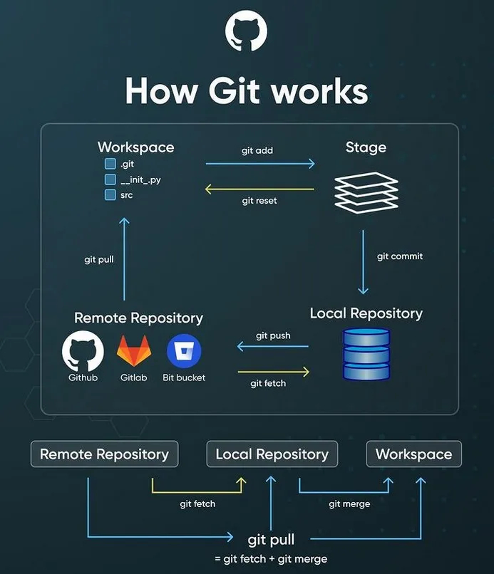

# Tools & Workflow

[**<-- VOLVER AL INICIO**](/README.md)


## Email @

Mantener un correo electrónico separado para el trabajo de desarrollo de software y algoritmos ofrece múltiples beneficios. Primero, ayuda a separar tus actividades profesionales de las personales, facilitando una comunicación clara y organizada, especialmente en proyectos múltiples o con diferentes clientes. Además, contribuye a mantener una bandeja de entrada ordenada y enfocada en las comunicaciones relacionadas con el desarrollo de software, reduciendo la posibilidad de perder mensajes importantes. 

Por otro lado, garantiza la seguridad y privacidad de las comunicaciones laborales, especialmente en proyectos sensibles. Un correo electrónico con un dominio profesional también refuerza tu imagen como experto en desarrollo de software al comunicarte con colegas, clientes y reclutadores. 

Finalmente, permite una gestión precisa de suscripciones y notificaciones relacionadas con el desarrollo de software, mejorando la eficiencia en la gestión de comunicaciones en este ámbito.

&nbsp;

## Command Line Interface (CLI)


La interfaz de línea de comandos (CLI) es una forma de interactuar con un sistema informático a través de comandos de texto. Aunque puede parecer intimidante al principio, aprender a usar la CLI puede ser muy útil para los desarrolladores de software, ya que la CLI ofrece una serie de ventajas:

**Eficiencia**: puede ser mucho más rápida que las interfaces gráficas de usuario (GUI) para realizar ciertas tareas, especialmente aquellas que implican la manipulación de archivos, la instalación de software o la ejecución de scripts.

**Automatización**: es ideal para la automatización de tareas repetitivas o secuenciales, ya que permite la creación de scripts y la ejecución de comandos en lotes.

**Control avanzado**: ofrece un mayor control sobre el sistema operativo y las aplicaciones, lo que puede ser útil para depurar problemas, realizar ajustes avanzados o realizar tareas que no son posibles a través de la GUI.

**Portabilidad**: es generalmente más portátil que las GUI, ya que los comandos suelen ser compatibles entre diferentes sistemas operativos y versiones.

**Aprendizaje**: puede ser una excelente manera de familiarizarse con el sistema operativo subyacente y adquirir habilidades técnicas más avanzadas.

**Flexibilidad**: ofrece una mayor flexibilidad en la forma en que interactúas con el sistema, lo que puede ser útil para adaptar el entorno de trabajo a tus necesidades específicas.

Las alternativas más comunes de CLI son `BASH` y `PowerShell`.

`Bash` es el shell predeterminado en la mayoría de las distribuciones de Linux y macOS.

`PowerShell` es el shell predeterminado en Windows.

### Guía de comandos en la Terminal (Bash o PowerShell)

#### Navegación en el Sistema de Archivos

- `cd <directorio>`: Cambiar al directorio especificado.
- `cd ..`: Retroceder al directorio padre
- `cd ~`: Cambiar al directorio de inicio del usuario.
- `cd /`: Cambiar al directorio raíz.
- `ls` (Bash) / `dir` (PowerShell): Listar archivos y directorios en el directorio actual.
- `pwd` (Bash) / `Get-Location` (PowerShell): Mostrar la ruta del directorio actual.

#### Manipulación de Archivos y Directorios

- `mkdir <nombre_directorio>`: Crear un nuevo directorio.
- `touch <nombre_archivo>`: Crear un nuevo archivo.
- `mv <fuente> <destino>`: Mover o renombrar archivos y directorios.
- `cp <fuente> <destino>`: Copiar archivos y directorios.
- `rm <archivo>`: Eliminar un archivo.
- `rm -r <directorio>`: Eliminar un directorio y su contenido de manera recursiva.

#### Otros Comandos Útiles

- `echo <mensaje>`: Mostrar un mensaje en la terminal.
- `cat <archivo>`: Mostrar el contenido de un archivo.
- `grep <patrón> <archivo>`: Buscar un patrón en un archivo.
- `man <comando>`: Mostrar el manual de ayuda de un comando.


&nbsp;

## IDE (Integrated Development Environment)


Un entorno de desarrollo integrado (IDE) es una herramienta que combina varias funciones y herramientas para facilitar el desarrollo de software. Algunas de las características más comunes de un IDE incluyen:

**Editor de código**: Un editor de código integrado que proporciona resaltado de sintaxis, autocompletado, indentación automática y otras funciones para facilitar la escritura de código.

**Depurador** (Debugger): Un depurador integrado que permite ejecutar y depurar programas paso a paso, establecer puntos de interrupción, inspeccionar variables y realizar otras operaciones de depuración.

**Gestión de proyectos**: Herramientas para organizar y gestionar proyectos de software, incluyendo la capacidad de crear, abrir, guardar y estructurar proyectos.

**Control de versiones**: Integración con sistemas de control de versiones como Git, que permite realizar operaciones de control de versiones directamente desde el IDE.

**Compilación y ejecución**: Funciones para compilar, ejecutar y probar programas directamente desde el IDE, sin necesidad de utilizar la línea de comandos.

**Integración con herramientas externas** (Extensiones): Posibilidad de integrar el IDE con otras herramientas y servicios externos, como compiladores, linters, analizadores estáticos, generadores de documentación, etc.

**Personalización**: Capacidad de personalizar el entorno de desarrollo mediante la instalación de complementos, temas, atajos de teclado y otras configuraciones.

**Soporte para múltiples lenguajes**: Algunos IDEs ofrecen soporte para múltiples lenguajes de programación, lo que puede ser útil si trabajas con varios lenguajes o tecnologías.

**Productividad**: Las funciones integradas de un IDE pueden ayudarte a ser más productivo y eficiente en tu trabajo diario, ya que te permiten realizar tareas comunes de desarrollo de software de forma más rápida y sencilla.

**Facilidad de uso**: Los IDEs suelen tener una interfaz de usuario intuitiva y fácil de usar, lo que facilita la navegación y el uso de las diferentes funciones y herramientas disponibles.

**Soporte y comunidad**: Muchos IDEs cuentan con una amplia comunidad de usuarios y desarrolladores que pueden proporcionar soporte, tutoriales, complementos y otros recursos útiles.

**Integración con servicios en la nube**: Algunos IDEs ofrecen integración con servicios en la nube, como almacenamiento, alojamiento de repositorios, pruebas automatizadas, etc.

**Compatibilidad con múltiples plataformas**: Algunos IDEs son compatibles con múltiples sistemas operativos, lo que te permite utilizar la misma herramienta en diferentes entornos de desarrollo.

#### Visual Studio Code


El IDE recomendado para el curso es `Visual Studio Code (VSC)`.

[Descargar Visual Studio Code](https://code.visualstudio.com/)

VSC es un editor de código fuente desarrollado por Microsoft que ofrece una amplia gama de funciones y herramientas para facilitar el desarrollo de software.

Algunas de las extensionas más comunes en VSC para el uso en el curso son:

Claro, aquí tienes una tabla en formato Markdown con algunas de las extensiones populares de Visual Studio Code para diferentes áreas de desarrollo:

| Área           | Extensión VS Code                                        |
|----------------|-----------------------------------------------------------|
| C/C++          | [C/C++](https://marketplace.visualstudio.com/items?itemName=ms-vscode.cpptools)                                      |
| Arduino / ESP32| [PlatformIO IDE](https://marketplace.visualstudio.com/items?itemName=platformio.platformio-ide)                     |
| Markdown       | [Markdown All in One](https://marketplace.visualstudio.com/items?itemName=yzhang.markdown-all-in-one)               |
| Git            | [GitLens](https://marketplace.visualstudio.com/items?itemName=eamodio.gitlens)                                        |
| Github         | [GitHub Pull Requests and Issues](https://marketplace.visualstudio.com/items?itemName=GitHub.vscode-pull-request-github) |
| Python         | [Python](https://marketplace.visualstudio.com/items?itemName=ms-python.python)                                        |
| Copilot        | [GitHub Copilot](https://marketplace.visualstudio.com/items?itemName=GitHub.copilot)                                  |
| Processing     | [Processing Language](https://marketplace.visualstudio.com/items?itemName=Tobiah.language-pde)                        |
| HTML/CSS/JS    | [HTML CSS Support](https://marketplace.visualstudio.com/items?itemName=ecmel.vscode-html-css)                         |
| Diagramas        | [Draw.io Integration](https://marketplace.visualstudio.com/items?itemName=hediet.vscode-drawio)                        |

Puedes explorar más extensiones en el [Marketplace de VS Code](https://marketplace.visualstudio.com/).

&nbsp;

## Version Control: Git y Github / Gitlab


El control de versiones es un sistema que registra los cambios realizados en un archivo o conjunto de archivos a lo largo del tiempo, de modo que puedas recuperar versiones anteriores en caso de necesidad. El uso de un software de control de versiones es fundamental en el desarrollo de software por varias razones clave. En primer lugar, proporciona un registro histórico completo de todos los cambios realizados en el código fuente a lo largo del tiempo, lo que facilita la colaboración entre equipos y el seguimiento de la evolución del proyecto. Además, el control de versiones permite a los desarrolladores trabajar de manera simultánea en diferentes partes del código sin temor a sobrescribir el trabajo de los demás, gracias a la capacidad de fusionar y gestionar cambios de forma eficiente. Esto promueve un flujo de trabajo colaborativo y reduce los conflictos. Además, el control de versiones facilita la identificación y corrección de errores al proporcionar la capacidad de retroceder a versiones anteriores del código en caso de problemas. En resumen, el uso de un software de control de versiones es esencial para garantizar la integridad, la colaboración y la eficiencia en el desarrollo de software

### Git

Git es un sistema de control de versiones distribuido que permite a los desarrolladores rastrear los cambios en el código fuente y colaborar en proyectos de software de forma eficiente. Algunas de las características más importantes de Git incluyen:

**Distribuido**: Git es un sistema de control de versiones distribuido, lo que significa que cada desarrollador tiene una copia completa del repositorio en su máquina local. Esto permite a los desarrolladores trabajar de forma independiente y colaborar en proyectos sin necesidad de una conexión a Internet constante.

**Rápido y eficiente**: Git es conocido por su velocidad y eficiencia en la gestión de grandes repositorios y proyectos complejos. Esto se debe en parte a su diseño como sistema de control de versiones distribuido y a su capacidad para realizar operaciones de forma local.

**Ramas y fusiones**: Git permite a los desarrolladores trabajar en ramas independientes del código y fusionar los cambios de forma sencilla y eficiente. Esto facilita la colaboración en proyectos de software y la gestión de cambios complejos.

**Historial completo**: Git mantiene un historial completo de todos los cambios realizados en el código fuente a lo largo del tiempo, lo que permite a los desarrolladores rastrear la evolución del proyecto y retroceder a versiones anteriores en caso de necesidad.

**Integración con GitHub y GitLab**: Git se integra con plataformas de alojamiento de repositorios como GitHub y GitLab, lo que facilita la colaboración en proyectos de software y la gestión de repositorios remotos.

**Comandos y flujo de trabajo**: Git ofrece una amplia gama de comandos y funciones para gestionar repositorios, ramas, commits, fusiones, etiquetas y otras operaciones relacionadas con el control de versiones. Es importante familiarizarse con los comandos y el flujo de trabajo de Git para utilizarlo de forma eficiente en el desarrollo de software.

**Documentación y recursos**: Git cuenta con una amplia documentación oficial, tutoriales, guías y recursos en línea que pueden ayudarte a aprender a utilizar Git y aprovechar al máximo sus funciones y capacidades.

**Comunidad y soporte**: Git cuenta con una amplia comunidad de usuarios y desarrolladores que pueden proporcionar soporte, tutoriales, consejos y recursos adicionales para ayudarte a utilizar Git de forma eficiente en tus proyectos de software.

**Integración con IDEs y herramientas de desarrollo**: Git se integra con una amplia gama de IDEs, editores de código y herramientas de desarrollo, lo que facilita su uso en entornos de desarrollo de software.




#### 1: Instalar Git localmente

Instalar Git en tu computadora.

Puedes descargarlo desde el [sitio oficial de Git](https://git-scm.com/) y seguir las [instrucciones de instalación](https://git-scm.com/book/es/v2/Inicio---Sobre-el-Control-de-Versiones-Instalaci%C3%B3n-de-Git) para tu sistema operativo.

**Tip:** _[Cómo instalar Git en Windows - Tutorial 2023](https://kinsta.com/es/base-de-conocimiento/instalar-git/)_

#### 2: Configurar Git

Después de instalar Git, necesitas configurar tu nombre de usuario y tu dirección de correo electrónico. Abre tu terminal y ejecuta los siguientes comandos, sustituyendo "TuNombre" y "tu@email.com" con tus propias credenciales:

```bash
git config --global user.name "TuNombre"
git config --global user.email "Tu@Email.com"
```

**Tip:** _Puedes verificar tu configuración en cualquier momento ejecutando:_

```bash
git config --list
```

#### 3: Crear un repositorio local

Abre tu terminal y navega al directorio donde deseas crear tu nuevo proyecto.

Ejecuta el siguiente comando para iniciar un nuevo repositorio Git:

`git init`

**Tip:** _Para acceder a un directorio utilizando la terminal Bash, puedes utilizar el comando cd (change directory). Aquí tienes un ejemplo básico:_

```bash
cd ruta/del/directorio
```

#### 4: Agregar archivos al repositorio (stage)

Coloca tus archivos en el directorio del proyecto.

Usa el siguiente comando para añadir todos los archivos al área de preparación:

`git add .`

#### 5: Realizar un commit

Después de agregar archivos, ejecuta el siguiente comando para realizar un commit:

`git commit -m "Mensaje descriptivo del commit"`

#### 6: Crear un repositorio en GitHub

Visita GitHub e inicia sesión en tu cuenta.

Haz clic en el botón "+" en la esquina superior derecha y selecciona "New repository".

Dale un nombre a tu repositorio, añade una descripción opcional y haz clic en "Create repository".

#### 7: Conectar el repositorio local con GitHub

En tu terminal, ejecuta el siguiente comando, sustituyendo nombreusuario y nuevorepositorio con tu nombre de usuario y el nombre del repositorio en GitHub:

```bash
git remote add origin https://github.com/nombreusuario/nuevorepositorio.git
```

Luego, sube tus cambios al repositorio remoto:

`git push -u origin main`

### Otras operaciones frecuentes

#### Verificar el estado del repositorio local

Para ver el estado de tu repositorio local, ejecuta el siguiente comando:

```bash
git status
```

#### Verificar el historial de commits

Para ver el historial de commits, ejecuta el siguiente comando:

```bash
git log
```

#### Clonar un repositorio

Para clonar un repositorio existente, ejecuta el siguiente comando en tu terminal:

```bash
git clone direccion-del-repositorio-externo.git
```

El repositorio se clonará en tu directorio actual.

#### Verificar el estado del repositorio remoto

Para ver el estado del repositorio remoto, ejecuta el siguiente comando:

Para verificar si hubo cambios en el repositorio remoto, puedes usar el comando `git fetch` seguido de git diff.

1. Ejecuta `git fetch origin` en la terminal. Esto traerá la información del repositorio remoto pero no hará ninguna modificación en tu repositorio local.

2. Ejecuta `git diff HEAD..origin/main` (o reemplaza `main` con el branch que estás siguiendo) para ver las diferencias entre tu último commit y el último commit en el repositorio remoto.

```bash
git fetch origin
git diff HEAD..origin/master
```


&nbsp;

## AI Code Assistants

<!-- imagen de cabecera -->

Un asistente de código con IA (_AI code assistant_) es una herramienta que usa un modelo de lenguaje (LLM) para ayudar a escribir, entender, depurar y modificar código. En pocos años estas herramientas cambiaron mucho:

- **2021–2022, autocompletado**: el asistente sugería la línea o la función siguiente mientras escribíamos (GitHub Copilot).
- **2023–2024, chat**: le hacíamos preguntas sobre el código en una ventana de conversación y copiábamos las respuestas al editor.
- **2025–2026, agentes**: el asistente lee el proyecto completo, ejecuta comandos en la terminal, corre los tests, edita varios archivos y hace commits. La persona describe la tarea, revisa el resultado y decide qué se acepta.

> **Nota (noviembre 2026):** esta es una de las áreas que más rápido cambia en el desarrollo de software. Los nombres de modelos, precios y planes que aparecen acá cambian mes a mes. Antes de elegir una herramienta, conviene revisar la documentación oficial de cada una.

### Conceptos clave

**Modelo vs. agente (harness)**: el _modelo_ es el LLM que genera texto y código (por ejemplo Claude Opus, GPT o Gemini). El _agente_ o _harness_ es el programa que lo rodea y le da herramientas: leer y escribir archivos, ejecutar comandos, buscar en el repositorio o usar git. Un mismo agente puede funcionar con distintos modelos, y un mismo modelo se puede usar desde distintos agentes.

**Ventana de contexto**: es la cantidad de texto (en _tokens_) que el modelo puede "tener en mente" a la vez. En 2026 los modelos principales ya manejan alrededor de 1 millón de tokens, lo que alcanza para proyectos medianos completos. Aun así, cuanto más acotada y clara es la tarea, mejor responde el modelo.

**Archivos de instrucciones del proyecto**: son archivos Markdown en la raíz del repositorio con lo que el agente tiene que saber del proyecto: cómo se compila, cómo se corren los tests, qué convenciones de código se usan, etc. Cada herramienta tiene el suyo: `CLAUDE.md` (Claude Code), `GEMINI.md` (Gemini/Antigravity) y [`AGENTS.md`](https://agents.md), un formato abierto que adoptaron Codex y muchas otras herramientas.

**MCP (Model Context Protocol)**: es un [protocolo abierto](https://modelcontextprotocol.io) para conectar agentes con herramientas y fuentes de datos externas, como bases de datos, documentación, navegadores web o APIs. Casi todos los agentes actuales lo soportan.

**Permisos y modo plan**: los agentes piden autorización antes de ejecutar comandos o modificar archivos, y en general se puede configurar qué tienen permitido hacer solos. Muchos ofrecen además un _modo plan_: el agente investiga y propone qué va a hacer, y recién actúa cuando la persona lo aprueba.

**Agentes locales vs. agentes en la nube**: un agente local trabaja en tu computadora, sobre tus archivos. Un agente en la nube trabaja en una máquina virtual remota sobre una copia del repositorio y, al terminar, abre un _pull request_ en GitHub para que lo revises.

### Tipos de herramientas

| Categoría | Ejemplos | Uso típico |
|-----------|----------|------------|
| Autocompletado y chat en el IDE | GitHub Copilot | Sugerencias mientras escribís, preguntas puntuales sobre el código |
| IDE agéntico | Cursor 3, Google Antigravity 2.0, VS Code + Copilot (agent mode) | Editor pensado alrededor del agente, con varias tareas en paralelo |
| Agente de terminal (CLI) | Claude Code, Codex CLI, Antigravity CLI, OpenCode, Aider | Trabajar sobre el repositorio desde la línea de comandos, automatizar y usar con git |
| Agente en la nube | Codex cloud, Jules, Copilot cloud agent, Claude Code en la web | Delegar una tarea completa y recibir un _pull request_ |

Muchas de estas herramientas existen en más de una forma. Por ejemplo, Claude Code y Codex tienen versión de terminal, extensión para VS Code, aplicación de escritorio y versión web.

### Herramientas privativas

#### Claude Code (Anthropic)

[Claude Code](https://www.anthropic.com/claude-code) es el agente de programación de Anthropic. Empezó como herramienta de terminal y hoy está disponible como CLI, como extensión para VS Code y JetBrains, en la aplicación de escritorio y en la web.

**Modelos**: usa la familia Claude. Desde el 22 de septiembre de 2026 el modelo por defecto es **Claude Opus 5.5**, con contexto de 1M de tokens. **Claude Fable 5.1** es el modelo más capaz y el más caro. **Sonnet 5.5** y **Haiku 5.5** son opciones más rápidas y económicas.

**Características**: archivo de instrucciones `CLAUDE.md`, modo plan, subagentes que trabajan en paralelo, _hooks_ para automatizar acciones (por ejemplo, correr el linter después de cada edición), _skills_ (paquetes de instrucciones reutilizables) y soporte de MCP.

**Acceso**: viene incluido en los planes Claude Pro (USD 20/mes) y Max (desde USD 100/mes). También se puede usar pagando por consumo a través de la API.

```bash
# Instalación (macOS / Linux)
curl -fsSL https://claude.ai/install.sh | bash

# Usarlo dentro de un proyecto
cd mi-proyecto
claude
```

#### OpenAI Codex

[Codex](https://github.com/openai/codex) es la propuesta de OpenAI. Está formada por **Codex CLI**, un agente de terminal _open source_ escrito en Rust, una extensión para el IDE y **Codex cloud**, un agente en la nube que trabaja sobre tus repositorios de GitHub.

**Modelos**: usa la familia GPT-6 (Sol, el modelo grande, y Luna, el liviano). Desde el DevDay 2026 (29 de septiembre) el modelo por defecto para programar es **GPT-6.1 Sol**.

**Características**: lee las instrucciones del proyecto desde `AGENTS.md`, tiene modos de aprobación configurables y ejecuta los comandos en un _sandbox_ (entorno aislado).

**Acceso**: viene incluido en los planes de ChatGPT (Plus, USD 20/mes, y otros). Hay también un plan Go más económico, y se puede usar por API.

```bash
npm install -g @openai/codex
cd mi-proyecto
codex
```

#### Google: de Gemini CLI a Antigravity

Google cambió de estrategia durante 2026:

- **Gemini CLI**, su agente de terminal _open source_ (Apache 2.0), dejó de funcionar para las cuentas individuales y gratuitas el 18 de junio de 2026. El repositorio se sigue manteniendo para clientes empresariales.
- Lo reemplazó **[Antigravity CLI](https://antigravity.google)**, presentado en Google I/O (mayo 2026) junto con **Antigravity 2.0**, un IDE de escritorio pensado para coordinar varios agentes. A diferencia de Gemini CLI, Antigravity CLI **no es open source**.
- **[Jules](https://jules.google)** es el agente en la nube de Google: toma una tarea, trabaja en una máquina virtual y abre un _pull request_.

**Modelos**: **Gemini 3.5 Flash** es el modelo por defecto, rápido y económico. **Gemini 3.5 Pro** es la opción más potente. Según los anuncios de Google, Antigravity también permite usar algunos modelos de otras empresas.

**Características**: archivo de instrucciones `GEMINI.md` y buena integración con el ecosistema de Google (Cloud, Firebase, Android).

#### Otros: GitHub Copilot y Cursor

**[GitHub Copilot](https://github.com/features/copilot)** fue el primer asistente masivo. Hoy incluye _agent mode_ dentro de VS Code y un _cloud agent_ que trabaja directamente sobre issues y pull requests de GitHub. Permite elegir entre modelos de varias empresas (Anthropic, OpenAI, Google). **Es gratuito para estudiantes** a través de GitHub Education: ver la [guía para estudiantes](/Recursos/info_curso.md#github-copilot).

**[Cursor](https://cursor.com)** es un editor basado en VS Code. Desde la versión 3 (abril 2026) está organizado alrededor de los agentes y deja el editor tradicional como espacio de revisión. También permite elegir entre modelos de distintas empresas.

### Modelos abiertos (open weights) y modelos chinos

Junto a las herramientas privativas creció un ecosistema de **modelos abiertos**, liderado en buena parte por laboratorios chinos. En 2026 sus resultados en programación están cerca de los mejores modelos cerrados, y su precio por API es mucho menor.

Hay que distinguir dos cosas:

- **Open source**: el código, los datos y el proceso de entrenamiento son públicos. Es poco común en modelos grandes.
- **Open weights** (pesos abiertos): se publican los _pesos_ del modelo ya entrenado, que se pueden descargar, ejecutar y adaptar, pero no necesariamente los datos de entrenamiento. Es el caso de casi todos los modelos de esta sección.

La **licencia** importa. Algunas son permisivas (MIT, Apache 2.0) y otras son propias, con condiciones extra para empresas muy grandes. Para uso educativo y personal en general no hay problema, pero conviene leerla antes de usar un modelo en un proyecto comercial.

**[DeepSeek](https://api-docs.deepseek.com) V4**: el preview salió el 24 de abril de 2026 con licencia MIT y contexto de 1M de tokens. Tiene dos versiones: **V4-Pro** (1.6 billones de parámetros totales, 49 mil millones activos por token), disponible de forma general desde agosto, y **V4-Flash** (284 mil millones totales, 13 mil millones activos), más rápida y económica. En septiembre y octubre llegaron actualizaciones de Flash (V4.1-Flash). Su API es compatible con los formatos de OpenAI y de Anthropic, así que se puede usar desde muchos agentes existentes.

**[Kimi](https://github.com/MoonshotAI) K3 (Moonshot AI)**: salió en julio de 2026, con pesos publicados pocos días después bajo una licencia propia. Tiene alrededor de 2.8 billones de parámetros y es uno de los modelos abiertos más fuertes en tareas de programación.

**[GLM](https://github.com/zai-org)-5.3 (Z.ai)**: salió en agosto de 2026. Se destaca en tareas agénticas largas, con muchos pasos encadenados. Usa una licencia de estilo MIT con condiciones adicionales para empresas muy grandes.

**[Qwen](https://github.com/QwenLM) (Alibaba)**: la familia Qwen ofrece modelos de muchos tamaños, desde gigantes hasta modelos chicos, en su mayoría con licencia Apache 2.0. Los modelos medianos de Qwen 3.x y la línea **Qwen3-Coder** son hoy la opción más realista para programar con un modelo que corre en la propia computadora.

| Modelo | Empresa | Lanzamiento | Licencia | ¿Corre en una laptop? |
|--------|---------|-------------|----------|-----------------------|
| DeepSeek V4 / V4.1 | DeepSeek | abril–octubre 2026 | MIT | No (vía API) |
| Kimi K3 | Moonshot AI | julio 2026 | Propia | No (vía API) |
| GLM-5.3 | Z.ai | agosto 2026 | Estilo MIT con condiciones | No (vía API) |
| Qwen 3.x / Qwen3-Coder | Alibaba | 2025–2026 | Apache 2.0 (mayoría) | Sí, las versiones chicas y medianas |

#### Agentes open source y uso local

Los modelos abiertos se pueden usar desde agentes que también son _open source_:

- **[OpenCode](https://opencode.ai)**: agente de terminal (licencia MIT) que funciona con casi cualquier proveedor de modelos, incluidos modelos locales.
- **[Aider](https://aider.chat)**: agente de terminal muy integrado con git, que hace un commit por cada cambio.
- **[Cline](https://cline.bot)** y **[Kilo Code](https://kilo.ai)**: extensiones para VS Code con modo agente.

Para **correr modelos en tu propia computadora** se usan herramientas como **[Ollama](https://ollama.com)** o **[LM Studio](https://lmstudio.ai)**, que descargan el modelo y lo exponen como un servidor local. La ventaja es la privacidad (el código no sale de tu máquina) y el costo cero por uso. La limitación es el hardware: los modelos de cientos de miles de millones de parámetros solo se pueden usar por API. En una laptop con Apple Silicon (16 GB de RAM o más) o una PC con una GPU de consumo funcionan bien modelos de 7 a 30 mil millones de parámetros en versión _cuantizada_ (comprimida). Son útiles, pero más limitados que los grandes.

```bash
# Descargar un modelo de código con Ollama
ollama pull qwen3-coder

# Usarlo desde Aider
aider --model ollama_chat/qwen3-coder
```

### Tabla comparativa general

| Herramienta | Empresa | Tipo | Licencia de la herramienta | Modelo por defecto (nov. 2026) | Instrucciones | Costo de entrada |
|-------------|---------|------|----------------------------|--------------------------------|---------------|------------------|
| Claude Code | Anthropic | CLI, IDE, escritorio, web | Privativa | Claude Opus 5.5 | `CLAUDE.md` | Claude Pro (USD 20/mes) |
| Codex | OpenAI | CLI, IDE, nube | CLI open source (Apache 2.0) | GPT-6.1 Sol | `AGENTS.md` | ChatGPT Go / Plus |
| Antigravity / Jules | Google | IDE, CLI, nube | Privativa | Gemini 3.5 Flash | `GEMINI.md` | Plan gratuito con límites |
| GitHub Copilot | GitHub / Microsoft | IDE, nube | Privativa | Varios (a elección) | `AGENTS.md` y propios | Gratis para estudiantes |
| Cursor | Anysphere | IDE | Privativa | Varios (a elección) | `AGENTS.md` y propios | Plan gratuito / Pro USD 20 |
| OpenCode / Aider / Cline | Comunidad | CLI, IDE | Open source | El que elijas (API o local) | `AGENTS.md` y propios | Gratis (+ costo de API, si se usa) |

### Benchmarks: cómo leerlos

Para comparar modelos y agentes de programación se usan _benchmarks_, conjuntos de tareas estandarizadas. Los más citados son:

- **[SWE-bench](https://www.swebench.com)** (Verified, Pro): issues reales de repositorios de GitHub que el agente tiene que resolver, con tests que verifican la solución.
- **[Terminal-Bench](https://www.tbench.ai)**: tareas completas en la terminal, como compilar, configurar entornos o depurar.

Hay que leerlos con cuidado. Muchas cifras las publica el mismo fabricante, el resultado depende tanto del modelo como del agente que lo usa, y los modelos pueden terminar "entrenados para el examen". Un benchmark sirve como orientación general. La mejor prueba es usar la herramienta en tus propios proyectos.

### Recursos

- [Claude Code](https://www.anthropic.com/claude-code)
- [OpenAI Codex (GitHub)](https://github.com/openai/codex)
- [Google Antigravity](https://antigravity.google) · [Jules](https://jules.google)
- [GitHub Copilot](https://github.com/features/copilot) · [Cursor](https://cursor.com)
- [DeepSeek API Docs](https://api-docs.deepseek.com) · [Hugging Face](https://huggingface.co) (repositorio de modelos abiertos)
- [Ollama](https://ollama.com) · [LM Studio](https://lmstudio.ai)
- [OpenCode](https://opencode.ai) · [Aider](https://aider.chat) · [Cline](https://cline.bot)
- [Model Context Protocol](https://modelcontextprotocol.io) · [AGENTS.md](https://agents.md)

&nbsp;

## Documentación de proyectos: Markdown


[ver Guía en Español](https://code.visualstudio.com)

Markdown es un lenguaje de marcado ligero que se utiliza comúnmente para escribir documentación de proyectos, tutoriales, guías, informes y otros tipos de contenido en formato de texto plano. Markdown es fácil de aprender, flexible y compatible con una amplia gama de plataformas y herramientas, lo que lo convierte en una excelente opción para escribir documentación de proyectos de software.

A continuación se muestran las pricipales herramientas y recursos para escribir documentación en Markdown:


### Encabezados

Utiliza el símbolo `#` seguido de un espacio para crear encabezados. Cuantos más `#` uses, más pequeño será el encabezado. Por ejemplo:

```
# Encabezado de nivel 1
## Encabezado de nivel 2
### Encabezado de nivel 3
```

### Listas

Puedes crear listas ordenadas y no ordenadas de la siguiente manera:

```
- Elemento 1
- Elemento 2
  - Subelemento 1
  - Subelemento 2
  
1. Primer elemento
2. Segundo elemento
   - Subelemento A
   - Subelemento B
```

### Links

Para insertar enlaces, utiliza el siguiente formato:

```
[Texto del enlace](URL_del_enlace)
```

Por ejemplo:

```
[GitHub](https://github.com)
```

### Imágenes

Para insertar imágenes, utiliza el siguiente formato:

```

```

### Bloques de código

Puedes resaltar bloques de código utilizando comillas invertidas o triple comillas invertidas:

```
`Código en línea`
```

```python
def hello():
    print("¡Hola, mundo!")
```

### Énfasis

Puedes enfatizar texto utilizando asteriscos o guiones bajos:

```
*Texto en cursiva*
**Texto en negrita**
```

### Citas

Para citar texto, utiliza el símbolo `>` al principio de la línea:

```
> Esto es una cita.
```

¡Eso es todo! Con estos elementos básicos, puedes comenzar a crear documentación de proyectos utilizando Markdown. Es una forma simple y eficaz de mantener tus documentos organizados y legibles.

### Tablas

```
| Encabezado 1 | Encabezado 2 | Encabezado 3 |
|--------------|--------------|--------------|
| Celda 1      | Celda 2      | Celda 3      |
| Celda 4      | Celda 5      | Celda 6      |
```

Esto generará una tabla como esta:

| Encabezado 1 | Encabezado 2 | Encabezado 3 |
|--------------|--------------|--------------|
| Celda 1      | Celda 2      | Celda 3      |
| Celda 4      | Celda 5      | Celda 6      |

Puedes ajustar el ancho de las columnas agregando o eliminando guiones entre los encabezados y utilizando dos puntos para alinear el texto:

```
| Nombre       | Edad         | Ciudad       |
|--------------|:------------:|-------------:|
| Juan         | 25           | Buenos Aires |
| María        | 30           | Madrid       |
```

Esto resultaría en:

| Nombre       | Edad         | Ciudad       |
|--------------|:------------:|-------------:|
| Juan         | 25           | Buenos Aires |
| María        | 30           | Madrid       |

### Quarto Markdown


Quarto es una herramienta de publicación que permite crear documentos, presentaciones y sitios web a partir de archivos de texto plano. Utiliza un enfoque basado en Markdown, lo que facilita la escritura y el formateo de contenido. Quarto es especialmente útil para proyectos que requieren una combinación de texto, código y resultados de análisis.

Algunas características clave de Quarto incluyen:

- **Soporte para múltiples formatos de salida**: Puedes generar documentos PDF, HTML y otros formatos a partir del mismo archivo fuente.
- **Integración con R y Python**: Quarto permite ejecutar código en R y Python, lo que facilita la inclusión de análisis y visualizaciones en tus documentos.
- **Facilidad de uso**: Al igual que Markdown, Quarto es fácil de aprender y utilizar, lo que lo convierte en una excelente opción para la documentación de proyectos.

Para obtener más información sobre Quarto, visita su [sitio web oficial](https://quarto.org/).

## PlatformIO


PlatformIO es un ecosistema de desarrollo integrado (IDE) y un gestor de bibliotecas para proyectos de IoT y sistemas embebidos. Proporciona una interfaz unificada para trabajar con diferentes plataformas de hardware y frameworks de software.

Algunas características clave de PlatformIO incluyen:

- **Soporte para múltiples plataformas**: Puedes desarrollar para una variedad de placas y microcontroladores, incluyendo Arduino, ESP8266, ESP32, y más.
- **Gestión de bibliotecas**: PlatformIO facilita la instalación y actualización de bibliotecas de terceros, lo que simplifica la gestión de dependencias en tus proyectos.
- **Integración con editores de código**: Puedes utilizar PlatformIO con editores populares como Visual Studio Code, lo que mejora la experiencia de desarrollo con características como autocompletado y depuración.

Para obtener más información sobre PlatformIO, visita su [sitio web oficial](https://platformio.org/).

&nbsp;